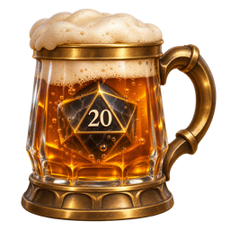
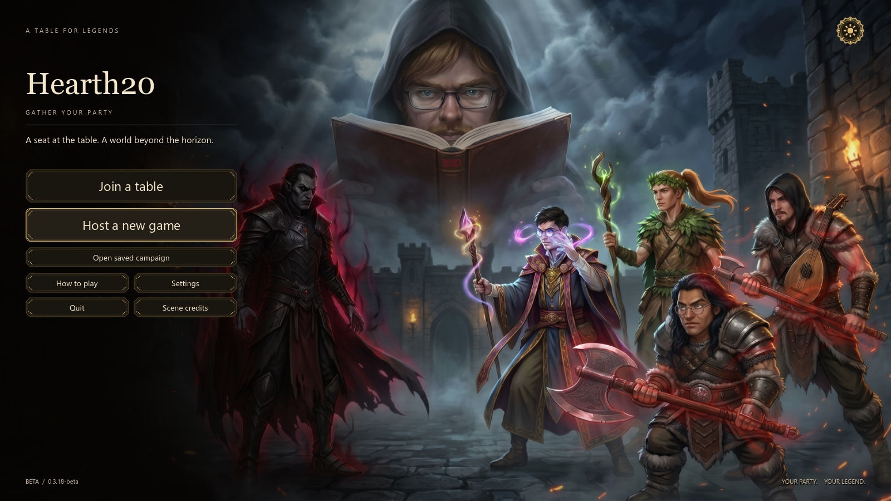

# Hearth20 Beta

A black-and-gold virtual tabletop with a first-person fantasy tavern, private D&D Beyond sheets and four multiplayer casino games.

Download the Windows x64 portable from the regular release. Open **Hearth20_Beta_Portable.exe** to play. The player edition includes the guided host/join flow. Diagnostics and the local testing lab are available in the separate development build. [Hearth20 Beta 0.3.18](https://github.com/WonderingMage/Hearth20/releases/tag/hearth20-beta-v0.3.18-beta)

The 0.3.18 update corrects Steam send-rate configuration: the app now applies matched chosen rates to each connection and adjusts them using measured traffic, quality and latency. **Connections → Connection details** shows requested and effective rates, actual traffic and queues. The previous high-maximum-only setting did not establish real available throughput. Actual speed on the user’s two-PC route still requires a new report or live test.

The DM now has one **Autosave** slot refreshed every five minutes during play. It saves a detached snapshot in the background, replaces the prior automatic slot after success and leaves manual named saves alone. A thin bottom bar reports progress without blocking actions; restore it through **Open saved tables**.

The 0.3.17 update downloads every loaded map and its foreground images in the background. Partial files continue across DM tab switches and concealment, and cached destinations do not download again. Each player sees the map of their deployed owned token; a token in inventory has no board view. The DM can browse other maps without changing player views. Drawings, movement, pings and measurements use each token’s map. The map-edge bar shows ready map-file counts, bytes and measured MB/s.

The 0.3.16 sidebar hotfix prevents Conceal/Reveal, Scene scrolling and routine refreshes from changing the selected page. Table → Help is replaced by a DM-only **Token Sheet** tab displaying **In development**. Creature imports and editable statistics remain future work. Player Chat and Journal selections stay selected during refreshes.

The 0.3.15 token-picker hotfix moves token image selection to the main window and uses the native Windows chooser. Cancel, Close and selecting an image explicitly release the dialog's input lock. The token inspector and inventory share this path, and the selected image remains tied to the original token if the board selection changes. Verification stays limited to token editing and map UI.

The 0.3.14 map/UI hotfix removes the unused **New scene** tab after import and fixes the DM losing input after **Bring all heroes here**. The context menu closes before changing maps; Escape and clicking outside dismiss it. Starter boards with authored content are retained, and stored-token ownership survives cleanup. This update's verification focuses on maps and UI; eating, drinking and gambling were not retested.

## Gather around the new menu

Join and Host lead the opening menu over the creator's revised fantasy party illustration. The exact 2752 × 1536 JPG is retained at full resolution with lossless texture import and gentle display sharpening. A separate crimson mist and weapon glow give the two axe-wielding warriors their rage aura; the base artwork and faces are preserved.

The title has saved campaigns, the illustrated host/join guide, Settings and artwork information. It loads directly into the seated table and releases its artwork node on transition. Retired creature showcases and the unused 3D title scene are excluded from portable exports.

## Complete playable map packages

Import a **.hearth20map** through **+ Map**. Its artwork, exact grid scale, walls, doors, windows, source-aware lights and separate foreground PNGs install together into a new campaign map. No manual size prompt is needed. Everything is embedded in the campaign for saving/reopening. Existing PNG/JPEG imports and automatic PNG grid metadata remain supported.

Give another map-making agent the [custom map guide](Hearth20-Custom-Map-Guide.md). It specifies cohesive overhead artwork, measured placement, wall/aperture geometry, finite sunlight casts, board north, roofs, foregrounds, schema and validation. The release's **Hearth20-Map-Authoring-Kit.zip** includes the standalone Python packer and a complete editable inn example. Packages are bounded data-only stored archives, validated before campaign mutation.

Loaded maps appear as scrollable host tabs. Right-click a particular tab → **Bring all heroes here** to gather deployed and stored heroes onto clear square centers, preserving control grants. **Cover map** stays on across tab switches and imports until the host explicitly reveals. Players see a thin received-byte progress bar while a new map downloads, followed by **Preparing map…**. Recently received exact maps and lighting are reused from bounded caches to reduce repeated reveal traffic; unseen or changed art still needs transfer.

## Gather your party

1. Open Steam and Hearth20 on each PC, using different Steam accounts.
2. The DM chooses **Host a new game**. The guided screen prepares a private lobby. **Quick invite…** opens Steam's invite overlay, or focuses friend-name search when the overlay is unavailable; Enter invites a unique match.
3. Players choose **Join a table** and accept the DM's invitation while Hearth20 is open.
4. Each new player gives a display name, character name and PNG. The character arrives in the DM's token inventory for placement and movement permission.

The title and connection screens include an illustrated host/join guide. Advanced connection provides Direct IP. Optional Steam networking currently uses Valve's shared AppID 480 and may appear as Spacewar.

## At the adventure table

Focus the battlemap to draw, add styled text, measure routes and areas, place effects, roll dice or manage tokens. The DM controls layers, common environmental lighting, day/night settings and map cover. Fifteen prepared maps demonstrate the tools and lighting. Token movement previews snap to square centers when grid snapping is enabled. Hold left and right-click to add movement waypoints, then release left to submit the route.

The DM can store tokens by dragging outside the map to an inventory target. Player ownership, portraits, map data, casino balances and campaign state are saved in the Campaign Vault. Save progress confirms completion and previous-copy recovery handles interrupted saves.

Click the papyrus to focus a private D&D Beyond sheet. The Windows-browser option uses a dedicated window in the user's normal browser. Sign-in, cookies and passwords stay on that PC. A built-in WebView2 option is also available.

## At the gilded casino

The DM uses the ceiling pulls to switch between adventure and casino. Three-Dragon Ante, Gambit of Ord, Run of Luck and Tymora's Spinner share one tavern. Players declare their gold, silver and copper, then receive private payout/refund totals to enter on D&D Beyond. Da Rolls provides chapters and illustrated instructions for each game.

Personal refreshments include fifteen foods and six drinks. Food lasts two bites and drinks three sips. Beer effects accumulate, blackout restricts the player to spectating, and waking clears the beer timers.

## Settings and automatic updates

Display settings include window/fullscreen modes, resolution, monitor, VSync, frame limits and smoothing. Display changes use a timed confirmation. Audio settings separate master, effects, party, creature-showcase and wake-up volumes.

Fresh installations use the ordinary **Beta releases** update channel. The title checks for updates and offers a verified download and restart. Existing Beta users can use **Settings → Updates → Check for updates**. Each download is checked against GitHub's SHA-256 digest and the Hearth20 edition manifest. The installer retains the previous EXE and supports rollback when startup confirmation fails.

If Windows or antivirus software blocks or removes the downloaded EXE or restart helper, the updater reports that possibility and leaves the current game running. These portables and custom helper are currently unsigned. Hash verification is not an antivirus approval; distribution signing and vendor false-positive review are still separate steps.

Use the same release on all participating PCs. Profiles, campaign saves and browser storage stay local. The optional combined update channel remains available in Settings for development test builds.

## Verification

The release includes **Verification-Report.md** with the exact scope of system checks, adversarial inputs, native UI tests, multiplayer campaign verification and update handling. The report also identifies checks requiring real accounts or target hardware. The GTX 1060 / i5-8500 30 FPS 1% low target still requires measurement on that hardware.

## Source and credits

**Hearth20-Full-Source.zip** contains the complete Godot project, large runtime assets and native components. Extract it and open **source/project.godot** with Godot 4.5.1. GitHub's automatic code archive omits large runtime assets.

Keep **Hearth20-Credits.md** with redistributed copies. **SHA256SUMS.txt** lists the release asset checksums. This repository is separate from the original Hearthtable project. Earlier Hearth20 forks retain their own saved checkpoints.
